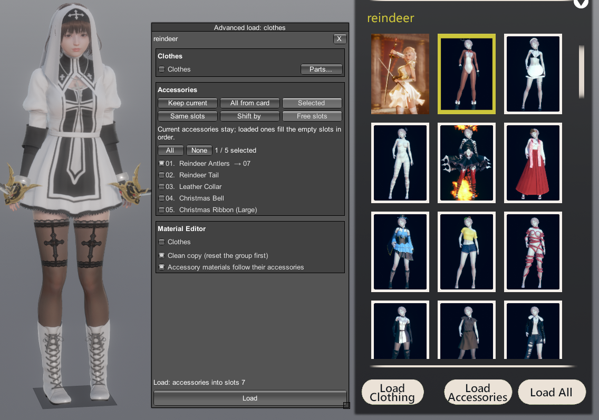

# Advanced Loader

A plugin that loads only specific parts of a card without overwriting the rest.

## Features

- **Advanced load** button next to the maker's *Load character* and *Clothes > Load* pages.
- **Body categories** (Breast, Legs, Eyes, Nose, Makeup…), including the ABMX bonemod sliders.
- **Clothes categories** (Top, Bottom, Inner top/bottom, Gloves, Pantyhose, Socks, Shoes), including their Material Editor data and clothes overlays.
- **Accessories**: select which accessories to copy, then either overwrite the old ones or put them into free slots.
- **Material Editor groups** (Body, Head, Eyes, Hair, Clothes) with the *Clean copy* feature: changes of the group are reset before the card's changes are applied, so nothing from earlier edits is left behind.
- The game's original load windows are not changed.

## Screenshots

| Character | Accessories, Material Editor, other plugins |
|---|---|
|  |  |
| **Accessories into free slots** | **Clothes** |
|  |  |

## Requirements

- [BepInEx](https://github.com/BepInEx/BepInEx) 5.4
- [HS2API](https://github.com/IllusionMods/IllusionModdingAPI) 1.48.1 or newer

## Installation

Copy `HS2_AdvancedLoader.dll` into `BepInEx\plugins`.

## Usage

1. In the character maker open *Load character* or *Clothes > Load*.
2. Click the **Advanced load** button and select a card in the game's list.
3. Tick what to load and press **Load** in **Advanced load**.

A keyboard shortcut for the window can be set in the plugin settings (F1).

## Compatibility

- [MoreAccessories](https://bitbucket.org/Joan6694/hsplugins) 1.2.2+
- [Material Editor](https://github.com/IllusionMods/KK_Plugins) 4.0.3.1+
- [ABMX](https://github.com/ManlyMarco/ABMX) 5.2.2+
- [Overlay Mods](https://github.com/ManlyMarco/Illusion-Overlay-Mods) 6.3+
- [Maker/Studio Browser Folders](https://github.com/ManlyMarco/Illusion_BrowserFolders)

## Changelog

- 1.0.0 — first public release.

## License

GPL-3.0, see [LICENSE](LICENSE).
