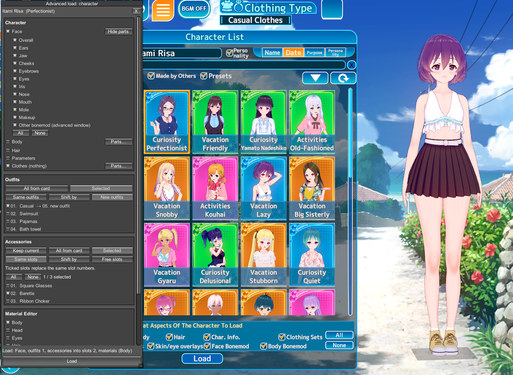
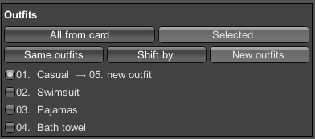
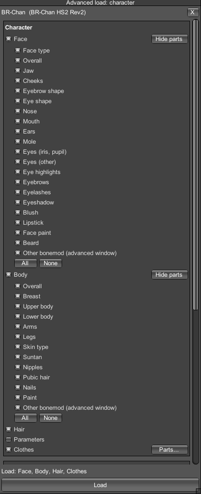
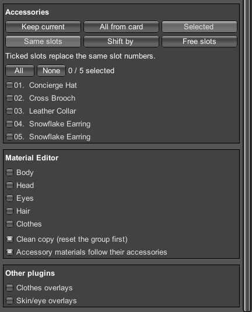
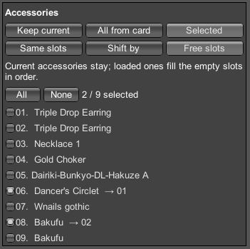
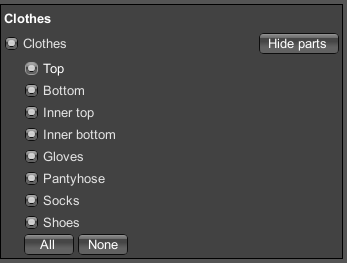

# Advanced Loader

A plugin that loads only specific parts of a card without overwriting the rest.

Supported games: Honey Select 2, Koikatsu Sunshine.

| Honey Select 2 | Koikatsu Sunshine |
|---|---|
|  |  |

## Features

- **Advanced load** button next to the maker's *Load character* and *Clothes > Load* pages.
- **Body categories** (Breast, Legs, Eyes, Nose, Makeup…), including the ABMX bonemod sliders.
- **Clothes categories** (Top, Bottom, Inner top/bottom, Gloves, Pantyhose, Socks, Shoes), including their Material Editor data and clothes overlays.
- **Accessories**: select which accessories to copy, then either overwrite the old ones or put them into free slots.
- **Material Editor groups** (Body, Head, Eyes, Hair, Clothes) with the *Clean copy* feature: changes of the group are reset before the card's changes are applied, so nothing from earlier edits is left behind.
- The game's original load windows are not changed.

### Koikatsu Sunshine: outfits

- Load all or chosen outfits into the same, shifted or new outfit slots; the other outfits are kept.

## Screenshots

| Character | Accessories, Material Editor, other plugins |
|---|---|
|  |  |
| **Accessories into free slots** | **Clothes** |
|  |  |

## Requirements

- [BepInEx](https://github.com/BepInEx/BepInEx) 5.4
- [HS2API / KKSAPI](https://github.com/IllusionMods/IllusionModdingAPI) 1.48 or newer

## Installation

Copy the file for your game into `BepInEx\plugins`:

- Honey Select 2: `HS2_AdvancedLoader.dll`
- Koikatsu Sunshine: `KKS_AdvancedLoader.dll`

## Usage

1. In the character maker open *Load character* or *Clothes > Load*.
2. Click the **Advanced load** button and select a card in the game's list.
3. Tick what to load and press **Load** in **Advanced load**.

A keyboard shortcut for the window can be set in the plugin settings (F1).

## Compatibility

| Plugin | HS2 | KKS |
|---|---|---|
| MoreAccessories | [1.2.2+](https://bitbucket.org/Joan6694/hsplugins) | [2.0.21+](https://github.com/jalil49/MoreAccessories) |
| [Material Editor](https://github.com/IllusionMods/KK_Plugins) | 4.0.3.1+ | 4.0.3+ |
| [ABMX](https://github.com/ManlyMarco/ABMX) | 5.2.2+ | 5.4+ |
| [Overlay Mods](https://github.com/ManlyMarco/Illusion-Overlay-Mods) | 6.3+ | 6.2+ |
| [More Outfit Slots](https://github.com/IllusionMods/KK_Plugins) | — | 1.1.2+ |
| [Maker/Studio Browser Folders](https://github.com/ManlyMarco/Illusion_BrowserFolders) | ✓ | ✓ |

## Changelog

- 1.1.0 — Koikatsu Sunshine version, outfit selection for Koikatsu Sunshine.
- 1.0.0 — first public release.

## License

GPL-3.0, see [LICENSE](LICENSE).
